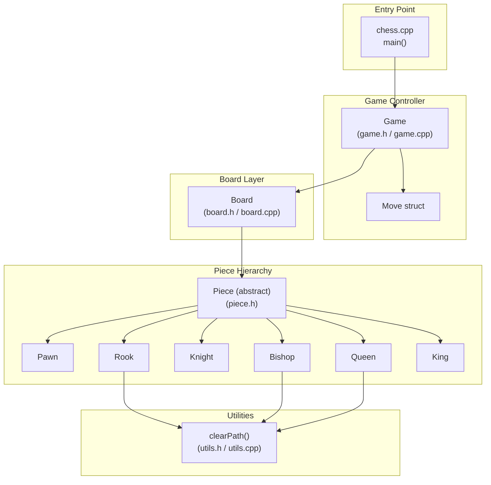
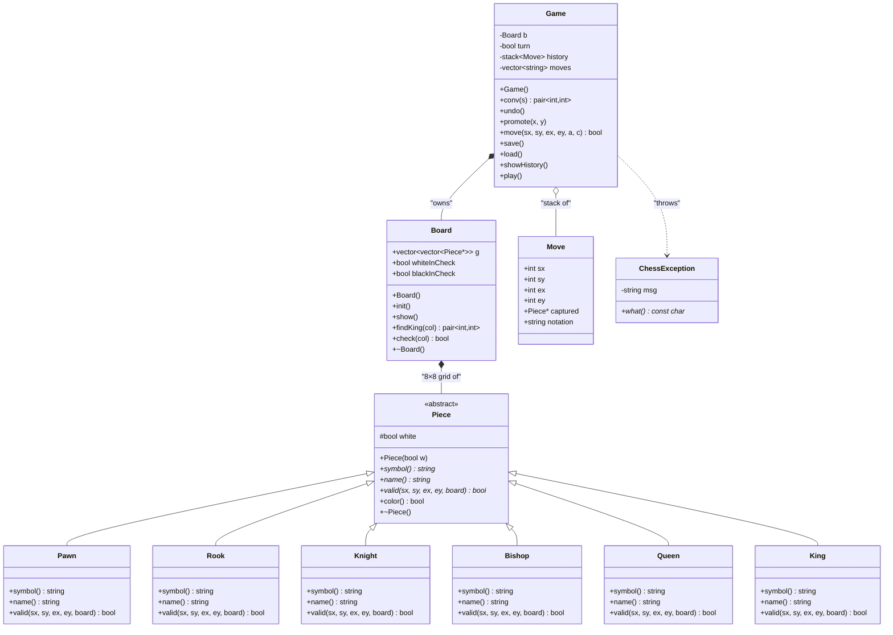
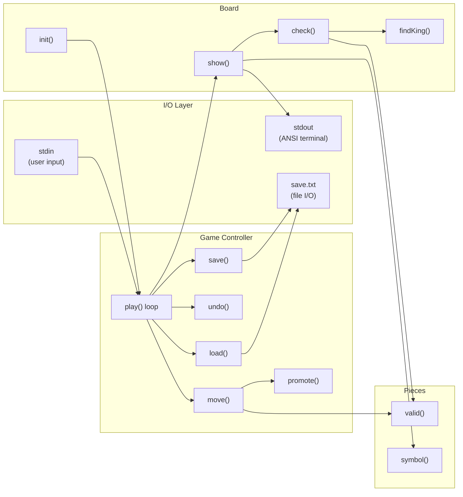
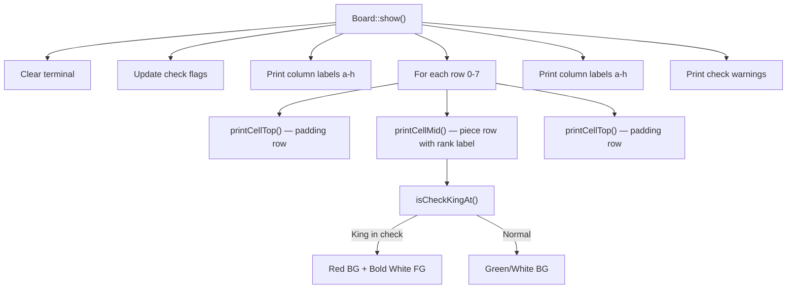
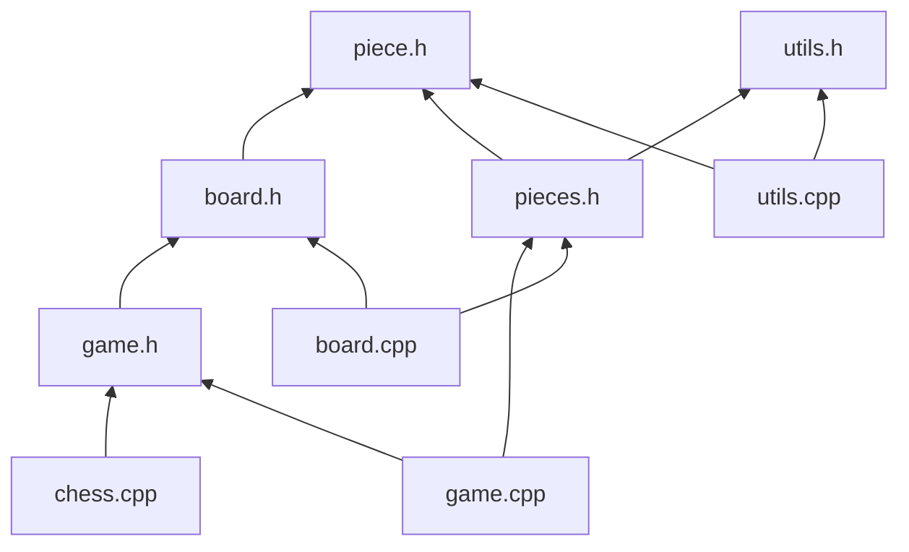

# ♟ Chess Project — Architecture & Design Document

## 📁 File Structure

```
chess/
├── chess.cpp          # Entry point — main()
├── piece.h            # Abstract base class Piece (interface)
├── pieces.h           # Concrete piece subclasses (Pawn, Rook, Knight, Bishop, Queen, King)
├── board.h            # Board class declaration
├── board.cpp          # Board implementation (init, render, check detection)
├── game.h             # Game class declaration + Move struct
├── game.cpp           # Game logic (play loop, move, undo, save/load, promote)
├── utils.h            # Utility function declarations
├── utils.cpp          # Utility function implementations (clearPath)
├── chess              # Compiled Linux binary
├── chess.exe          # Compiled Windows binary
├── a.exe              # Alternate Windows build
└── save.txt           # (runtime) Saved game state
```

---

## 🏗 High-Level Architecture



---

## 🧬 Class Hierarchy (UML)



---

## 🔄 Game Loop — Sequence Diagram

```mermaid
sequenceDiagram
    participant User
    participant Main as chess.cpp
    participant G as Game
    participant B as Board
    participant P as Piece

    Main->>G: Game g; g.play()
    loop Game Loop
        G->>B: b.show()
        B->>B: check(white), check(black)
        B->>B: Render 8×8 grid with ANSI colors
        B-->>User: Display board + check warnings
        G->>G: showHistory()
        G-->>User: Display move list

        User->>G: Input (e.g. "e2 e4")

        alt Command Input
            User->>G: "undo" / "save" / "load" / "exit"
            G->>G: Execute command
        else Move Input
            G->>G: conv("e2") → (6,4)
            G->>G: conv("e4") → (4,4)
            G->>P: b.g[6][4]->valid(6,4,4,4,board)
            P-->>G: true / false
            alt Valid Move
                G->>G: Execute move, push to history
                G->>G: promote() if pawn reaches end
                G->>G: Toggle turn
            else Invalid Move
                G-->>User: "ERROR: ..."
            end
        end
    end
```

---

## 📦 Component Interaction Map



---

## 🧩 Detailed File Breakdown

### 1. `chess.cpp` — Entry Point
| Aspect | Detail |
|---|---|
| **Purpose** | Application entry point |
| **Key Action** | Creates a `Game` object and calls `g.play()` |
| **Platform** | Sets UTF-8 console codepage on Windows (`SetConsoleCP(65001)`) |
| **Lines** | 17 |

---

### 2. `piece.h` — Abstract Base Class
| Aspect | Detail |
|---|---|
| **Purpose** | Defines the **polymorphic interface** for all chess pieces |
| **Key Members** | `white` (color flag), `symbol()`, `name()`, `valid()`, `color()` |
| **Design Pattern** | Strategy Pattern — each piece defines its own movement rules via `valid()` |
| **Lines** | 21 |

---

### 3. `pieces.h` — Concrete Piece Classes
| Class | Symbol (W/B) | Movement Rule |
|---|---|---|
| **Pawn** | ♙ / ♟ | Forward 1 (or 2 from start), diagonal capture |
| **Rook** | ♖ / ♜ | Straight lines (uses `clearPath`) |
| **Knight** | ♘ / ♞ | L-shape (2+1 or 1+2), can jump |
| **Bishop** | ♗ / ♝ | Diagonals (uses `clearPath`) |
| **Queen** | ♕ / ♛ | Straight + diagonal (uses `clearPath`) |
| **King** | ♔ / ♚ | One square in any direction |

---

### 4. `board.h` / `board.cpp` — Board Management
| Aspect | Detail |
|---|---|
| **Data Structure** | `vector<vector<Piece*>>` — 8×8 grid of piece pointers |
| **Rendering** | ANSI escape codes for colored terminal output |
| **Check Detection** | Iterates all opponent pieces; if any can capture the king → check |
| **Visual Features** | Green/white squares, gold labels, **red highlight** on king in check |
| **Memory** | Destructor cleans up all heap-allocated pieces |

**Rendering Architecture:**



---

### 5. `game.h` / `game.cpp` — Game Controller
| Feature | Implementation |
|---|---|
| **Turn Management** | `bool turn` — `true` = White, `false` = Black |
| **Move Validation** | Checks ownership → destination → piece-specific `valid()` |
| **Undo** | Stack-based (`stack<Move>`) — pops last move, restores captured piece |
| **Save/Load** | Text file (`save.txt`) — stores move notation, replays on load |
| **Promotion** | Prompts user when pawn reaches rank 1 or 8 (Q/R/B/N) |
| **Error Handling** | Custom `ChessException` class with descriptive messages |
| **Input Format** | Algebraic notation: `e2 e4`, or commands: `undo`, `save`, `load`, `exit` |

---

### 6. `utils.h` / `utils.cpp` — Path Utilities
| Function | Purpose |
|---|---|
| `clearPath(sx,sy,ex,ey,board)` | Checks if all intermediate squares between start and end are empty. Used by Rook, Bishop, and Queen for line-of-sight validation. |

---

## 🎨 Design Patterns Used

| Pattern | Where | Why |
|---|---|---|
| **Polymorphism / Strategy** | `Piece` hierarchy | Each piece encapsulates its own movement rules |
| **Template Method** | `Board::show()` | Fixed rendering algorithm, varying per-cell content |
| **Command** | `Move` struct + `history` stack | Enables undo functionality |
| **MVC-like Separation** | `Game` (Controller) / `Board` (Model+View) / `Piece` (Model) | Separates game logic from board state and rendering |

---

## 🔗 Dependency Graph (Header Includes)



---

## ⚙️ Build & Run

```bash
# Compile (C++17)
g++ -std=c++17 -o chess chess.cpp board.cpp game.cpp utils.cpp

# Run
./chess
```

> [!NOTE]
> The project uses Unicode chess symbols (♔♕♖♗♘♙♚♛♜♝♞♟) and ANSI escape codes for terminal rendering. On Windows, UTF-8 codepage is set via `SetConsoleCP(65001)`. On Linux/macOS, a UTF-8 capable terminal is required.
